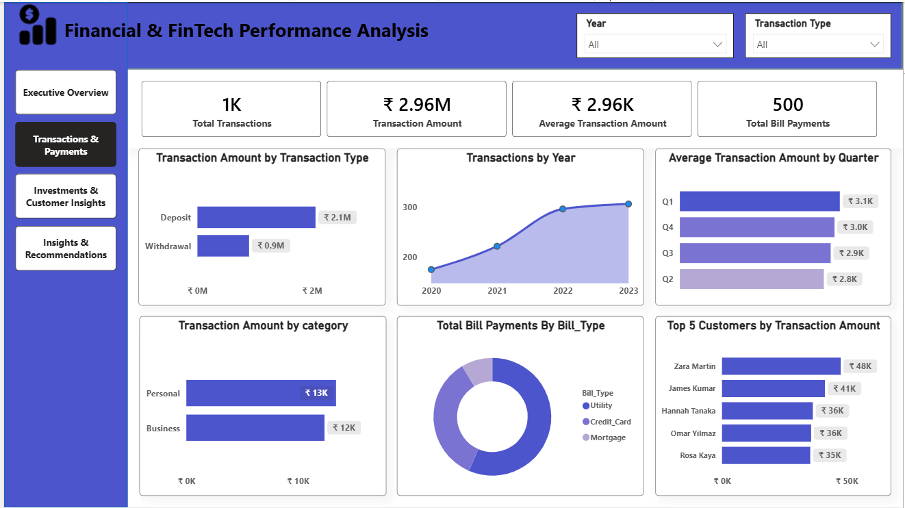
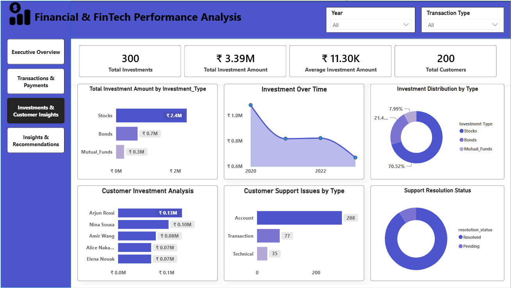
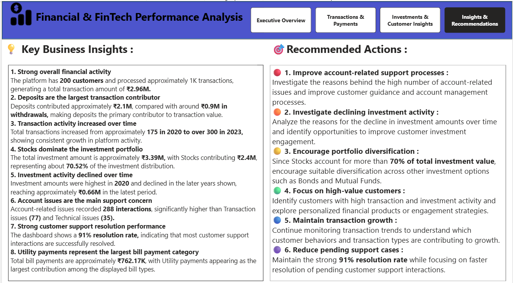

# 💰 Financial & FinTech Performance Analysis

### End-to-End Power BI Data Analytics Project

An end-to-end **Financial & FinTech Data Analytics project** that analyzes customer transactions, bill payments, investments, and customer support interactions to understand overall financial performance and support better business decisions.

This project focuses on building a complete analytics solution using **Power BI**, including data preparation, data modeling, DAX calculations, interactive dashboard development, and business insights.

---

# 📌 Project Overview

Financial and FinTech organizations manage data across multiple business areas, including customer transactions, bill payments, investments, and customer support.

This project brings these different data areas together into a structured Power BI data model to provide a unified view of financial performance and customer activity.

The analysis focuses on:

- Transaction performance
- Bill payment analysis
- Investment performance
- Customer activity
- Customer support issues
- Support resolution performance

---

# 🎯 Business Problem

A FinTech organization wants to better understand its financial operations and customer activity across multiple areas of the business.

The organization needs a centralized reporting solution to analyze transactions, payments, investments, and customer support performance.

### The business wants to understand:

- What is the overall transaction volume and transaction amount?
- Which transaction types contribute the most financial value?
- How are transactions performing over time?
- Which bill payment types have the highest activity?
- Which investment types contribute the most investment value?
- How are investments changing over time?
- Which customers have the highest investment activity?
- What are the most common customer support issues?
- How effectively are customer support interactions being resolved?

### Main Business Question

> **How can financial transaction, payment, investment, and customer support data be analyzed together to provide a clear view of business performance and support better operational decisions?**

---

# 🛠️ Technology Stack

| Technology | Purpose |
|---|---|
| Power BI | Data analysis, data modeling, and dashboard development |
| Power Query | Data cleaning and transformation |
| DAX | KPI and business calculations |
| Data Modeling | Creating relationships between fact and dimension tables |
| CSV / Multiple Data Sources | Source data used for analysis |
| AI Tools (ChatGPT / Claude / Gamma) | Supporting productivity, documentation, presentation preparation, and project planning |
| GitHub | Project documentation and portfolio delivery |

---

# 🔄 Project Workflow

```text
Multiple Source Datasets
        ↓
Power Query Data Preparation
        ↓
Data Cleaning & Transformation
        ↓
Data Modeling & Relationships
        ↓
DAX Measures & KPIs
        ↓
Interactive Power BI Dashboard
        ↓
Insights & Recommendations
```

---

# 📊 Data Model

The project uses multiple tables representing different areas of the FinTech business.

### Dimension Tables

- `Dim_Customers`
- `Dim_Transaction_Types`
- `Dim_Date`

### Fact Tables

- `fact_Transaction_table`
- `Fact_bill_payments`
- `fact_Investments`
- `Fact_customer_support`

The model connects the different business activity tables with shared dimensions to support consistent filtering and analysis.

### Key Modeling Activities

- Organized data into fact and dimension tables.
- Created relationships between customer data and business activity tables.
- Connected transaction type information to transaction analysis.
- Created a dedicated date table for time-based reporting.
- Used one-to-many relationships where appropriate.

---

# 🧹 Data Preparation Using Power Query

The source datasets were reviewed and prepared directly in Power BI.

### Activities Performed

- Reviewed multiple source tables.
- Checked and managed data types.
- Cleaned and transformed data where required.
- Organized tables for analytical modeling.
- Prepared data for DAX calculations and dashboard reporting.

The goal was to create an analysis-ready data model for reporting across transactions, payments, investments, and customer support.

---

# 🧮 DAX Measures and KPIs

DAX measures were created to calculate important business metrics and support interactive reporting.

### Key KPIs Include

- Total Customers
- Total Transactions
- Transaction Amount
- Average Transaction Amount
- Total Bill Payments
- Total Investment Amount
- Average Investment Amount
- Total Investments
- Support Resolution Rate

These measures are used throughout the dashboard to provide a consistent view of financial and operational performance.

---

# 📊 Power BI Dashboard

The final Power BI report contains **four interactive pages** designed to provide both high-level and detailed business analysis.

---

## 📈 1. Executive Overview

Provides a high-level summary of overall financial and customer support performance.

### Key KPIs

- Total Customers
- Total Transactions
- Transaction Amount
- Investment Amount
- Total Bill Amount
- Resolution Rate

### Analysis Areas

- Transaction Amount by Transaction Type
- Total Bill Payments by Bill Type
- Total Investment Amount by Investment Type
- Total Transactions by Year
- Support Interactions by Resolution Status
- Total Support Interactions by Issue Type


---

## 💳 2. Transactions & Payments

Provides a detailed analysis of customer transactions and bill payment activity.

### Key KPIs

- Total Transactions
- Transaction Amount
- Average Transaction Amount
- Total Bill Payments

### Analysis Areas

- Transaction Amount by Transaction Type
- Transactions by Year
- Average Transaction Amount by Quarter
- Transaction Amount by Category
- Total Bill Payments by Bill Type
- Top 5 Customers by Transaction Amount



---

## 📈 3. Investments & Customer Insights

Provides detailed insights into investment performance and customer support activity.

### Key KPIs

- Total Investments
- Total Investment Amount
- Average Investment Amount
- Total Customers

### Analysis Areas

- Total Investment Amount by Investment Type
- Investment Over Time
- Investment Distribution by Type
- Customer Investment Analysis
- Customer Support Issues by Type
- Support Resolution Status



---

## 💡 4. Insights & Recommendations

The final page summarizes the key findings from the analysis and provides actionable business recommendations.

### Focus Areas

- Transaction performance
- Investment performance
- Customer support trends
- Operational improvement opportunities
- Business recommendations



---

# 📈 Key Results

| KPI | Result |
|---|---:|
| Total Customers | 200 |
| Total Transactions | 1K |
| Transaction Amount | ₹2.96M |
| Investment Amount | ₹3.39M |
| Total Bill Amount | ₹762.17K |
| Resolution Rate | 91.00% |
| Total Investments | 300 |

---

# 💡 Key Business Insights

### 1. Deposits Drive the Highest Transaction Value

Deposits contributed approximately **₹2.1M**, compared with approximately **₹0.9M** from withdrawals. This indicates that deposits are the major contributor to overall transaction value.

### 2. Transaction Activity Increased Over Time

Transaction activity increased from approximately **175 transactions in 2020** to more than **300 transactions in 2023**, showing overall growth in transaction volume.

### 3. Stocks Represent the Largest Investment Category

Stocks contributed approximately **₹2.4M** of the total investment amount, making them the largest investment category in the available data.

### 4. Investment Performance Changes Over Time

Investment amounts varied across different years, highlighting the importance of monitoring investment trends and changes in customer investment behavior.

### 5. Customer Support Resolution Performance Is Strong

The analysis shows a **91% resolution rate**, indicating that most customer support interactions were successfully resolved.

### 6. Account Issues Are the Most Common Support Issue

Account-related issues represent the highest number of support interactions, followed by transaction and technical issues.

### 7. Customer-Level Analysis Identifies High-Value Customers

Customer investment analysis helps identify customers with higher investment amounts, which can support customer relationship and engagement strategies.

---

# 💼 Business Recommendations

### 1. Monitor Investment Trends

Regularly monitor investment performance across investment types and time periods to identify changes in customer investment behavior.

### 2. Improve Account Support Processes

Since account-related issues represent the largest support category, investigate common causes and improve support processes or self-service options.

### 3. Maintain Strong Resolution Performance

Continue monitoring unresolved customer interactions and identify opportunities to improve the current support resolution rate.

### 4. Use Customer-Level Insights

Use transaction and investment data to identify high-value customers and support more personalized customer engagement.

### 5. Monitor Transaction Growth

Track transaction activity over time to understand business growth patterns and support future operational planning.

### 6. Analyze Investment Preferences

Since stocks represent the largest share of investment value, continue analyzing investment preferences and monitor the distribution across investment categories.

---

# 📊 Skills Demonstrated

### Data Preparation

- Data Cleaning
- Data Transformation
- Data Type Management
- Multi-Table Data Preparation

### Data Modeling

- Fact and Dimension Tables
- One-to-Many Relationships
- Date Table Creation
- Multi-Fact Table Modeling

### DAX & Analysis

- KPI Calculations
- Aggregation Measures
- Average Calculations
- Percentage Measures
- Time-Based Analysis

### Power BI

- Interactive Dashboards
- KPI Cards
- Bar Charts
- Line Charts
- Donut Charts
- Slicers and Filters
- Business Storytelling

### Professional Workflow

- Business Problem Understanding
- Data Preparation
- Data Modeling
- DAX Calculations
- Dashboard Development
- Business Insights
- Recommendations
- Project Documentation

---

# 📁 Repository Structure

```text
Financial-and-FinTech-Performance-Analysis/
│
├── Financial-and-FinTech-Performance-Analysis.pdf
├── Financial-and-FinTech-Performance-Analysis_.pptx
│
├── Financial_FinTech_BRD_Download.docx
├── Financial_FinTech_Dashboard.pbix
├── Financial_FinTech_Developer_Handover_Guide_Final.docx
├── Financial_FinTech_User_Guide_Final.docx
│
├── Fintech_Executive_Overview.png
├── Fintech_Insights_Recommendations.png
├── Investments_Customer_Insights.png
├── Transactions_Payments.png
│
└── README.md
```

---

# 🚀 How to Run the Project

## Step 1 — Download the Project

Download or clone this repository and keep the project files together.

---

## Step 2 — Open the Power BI Dashboard

1. Install **Power BI Desktop**.
2. Open the following file:

```text
Financial_FinTech_Dashboard.pbix
```

3. Review the data model in **Model View**.
4. Refresh the data if required.
5. Navigate through the different dashboard pages.

---

## Step 3 — Explore the Dashboard

Use the available slicers to explore the data.

### Available Filters

- Year
- Transaction Type

Navigate through the report to analyze:

- Executive performance
- Transactions and payments
- Investments and customer insights
- Business insights and recommendations

---

# 📚 Project Documentation

This repository includes supporting project documentation.

### 📄 Business Requirements Document (BRD)

Explains the business situation, business problem, objectives, stakeholder requirements, KPIs, dashboard requirements, and project deliverables.

### 👤 User Guide

Explains how users can open, navigate, and interact with the Power BI dashboard.

### 🛠️ Developer Handover Guide

Provides technical information about the project workflow, data model, relationships, DAX calculations, dashboard structure, and future maintenance.

### 📊 Project Case Study

The project PDF provides an overview of the business problem, analysis process, dashboard findings, insights, and recommendations.

### 🎯 Project Presentation

The PowerPoint presentation summarizes the project workflow and key findings for project presentation purposes.

---

# 🔮 Future Improvements

Possible future enhancements include:

- Adding customer demographic and segmentation data.
- Including revenue and profitability metrics.
- Adding transaction success and failure analysis.
- Adding automated data refresh.
- Creating more detailed customer support performance metrics.
- Adding forecasting for transaction and investment trends.
- Integrating additional financial data sources.

---

# 👨‍💻 Developed By

**Anil Kumar**

Aspiring Data Analyst | Power BI | SQL | Python | Excel

GitHub: https://github.com/thandaanil987

LinkedIn: https://linkedin.com/in/thanda-anil-kumar-5817172a5

---

## ⭐ Project Summary

This project demonstrates an end-to-end **Power BI Data Analytics workflow** by transforming multiple financial datasets into an interactive reporting solution.

**Multiple Data Sources → Power Query → Data Modeling → DAX → Power BI Dashboard → Insights → Business Recommendations**

The project provides a unified view of **transactions, payments, investments, customers, and customer support performance**, demonstrating how multiple business datasets can be transformed into meaningful insights for decision-making.
