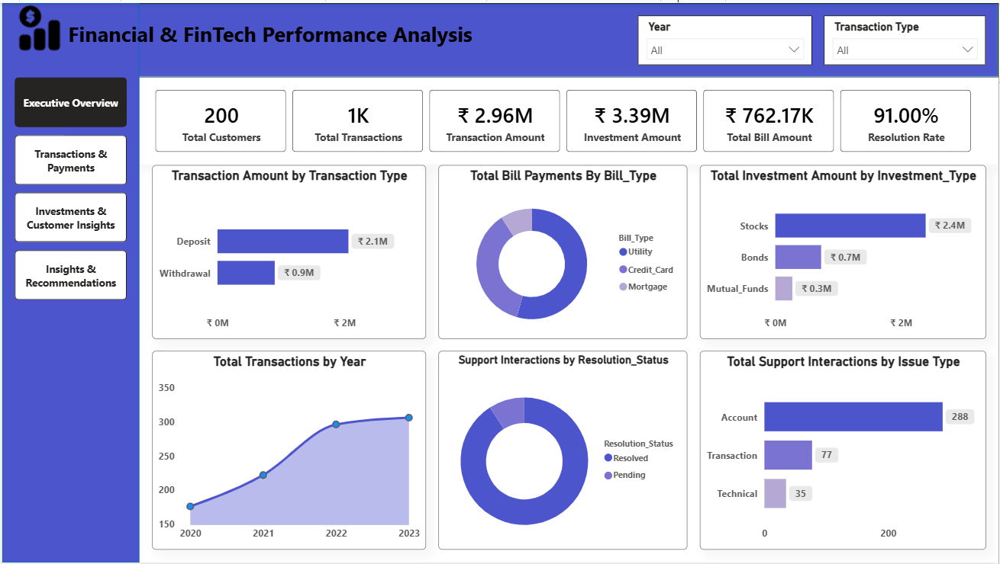

# 💰 Financial & FinTech Performance Analysis

### End-to-End Power BI Data Analytics Project

An end-to-end **Financial & FinTech Analytics project** that analyzes customer transactions, bill payments, investments, and customer support interactions to understand overall financial performance and support better business decisions.

This project focuses on building a complete **Power BI analytics solution**, including data preparation, data modeling using a star-schema approach, DAX calculations, interactive dashboard development, and business insights.

---

# 📌 Project Overview

Financial and FinTech organizations manage large volumes of customer transactions, payments, investments, and support interactions. However, data from these different business areas can be difficult to analyze together.

This project brings together multiple datasets into a structured Power BI data model to provide a unified view of financial performance and customer activity.

The analysis focuses on:

- Transaction performance
- Bill payment analysis
- Investment performance
- Customer activity
- Customer support issues
- Support resolution performance

---

# 🎯 Business Problem

A FinTech organization wants to better understand its financial operations and customer activity across multiple areas of the business.

The organization needs a centralized reporting solution to answer important questions about transactions, payments, investments, and customer support performance.

### The business wants to understand:

- What is the overall transaction volume and transaction amount?
- Which transaction types contribute the most financial value?
- How are transactions performing over time?
- Which bill payment types have the highest activity?
- Which investment types contribute the most investment value?
- How are investments changing over time?
- Which customers have the highest investment activity?
- What are the most common customer support issues?
- How effectively are customer support interactions being resolved?

### Main Business Question

> **How can financial transaction, payment, investment, and customer support data be analyzed together to provide a clear view of business performance and support better operational decisions?**

---

# 🛠️ Technology Stack

| Technology | Purpose |
|---|---|
| Power BI | Data analysis, data modeling, and dashboard development |
| Power Query | Data cleaning and transformation |
| DAX | KPI and business calculations |
| Star Schema | Structured data modeling |
| CSV / Multiple Data Sources | Source data for analysis |
| AI Tools (ChatGPT / Claude / Gamma) | Supporting productivity, documentation, presentation preparation, and project planning |
| GitHub | Project documentation and portfolio delivery |

---

# 🔄 Project Workflow

```text
Multiple Source Datasets
        ↓
Power Query Data Preparation
        ↓
Data Cleaning & Transformation
        ↓
Star Schema Data Modeling
        ↓
DAX Measures & KPIs
        ↓
Interactive Power BI Dashboard
        ↓
Business Insights & Recommendations
```

---

# 📊 Data Model

The project uses multiple tables representing different areas of the FinTech business.

### Dimension Tables

- `Dim_Customers`
- `Dim_Transaction_Types`
- `Dim_Date`

### Fact Tables

- `fact_Transaction_table`
- `Fact_bill_payments`
- `fact_Investments`
- `Fact_customer_support`

The data model connects the business fact tables with shared dimension tables to support efficient filtering and analysis.

### Key Relationships

- Customer data is connected to transactions, bill payments, investments, and customer support interactions.
- Transaction type information supports transaction-level analysis.
- The date table supports time-based analysis across the available fact tables.

This approach creates a structured analytical model suitable for reporting and business analysis.

---

# 🧹 Data Preparation Using Power Query

The source datasets were reviewed and prepared directly in Power BI.

### Activities Performed

- Reviewed the structure of multiple source tables
- Checked and prepared column data types
- Cleaned and transformed data where required
- Organized tables into fact and dimension tables
- Created a structured data model
- Prepared data for KPI calculations and dashboard reporting

The goal was to create an analysis-ready dataset while maintaining clear relationships between customers, transactions, payments, investments, and support interactions.

---

# 📐 Data Modeling

A structured data model was created in Power BI using dimension and fact tables.

### Modeling Activities

- Created and organized dimension tables
- Used multiple fact tables for different business processes
- Created relationships between customers and business activity tables
- Connected transaction type information to transaction analysis
- Created a dedicated date table for time-based reporting
- Used one-to-many relationships where appropriate

The data model supports consistent filtering and analysis across different areas of the dashboard.

---

# 🧮 DAX Measures and KPIs

DAX measures were created to calculate important business metrics and support interactive reporting.

### Key KPIs Include

- Total Customers
- Total Transactions
- Transaction Amount
- Average Transaction Amount
- Total Bill Payments
- Total Investment Amount
- Average Investment Amount
- Total Investments
- Support Resolution Rate
- Total Support Interactions

These measures are used throughout the dashboard to provide a consistent view of business performance.

---

# 📊 Power BI Dashboard

The final Power BI report contains **four interactive pages** designed to provide both high-level and detailed business analysis.

---

## 📈 1. Executive Overview

Provides a high-level summary of overall financial and customer support performance.

### Key KPIs

- Total Customers
- Total Transactions
- Transaction Amount
- Investment Amount
- Total Bill Amount
- Resolution Rate

### Analysis Areas

- Transaction Amount by Transaction Type
- Total Bill Payments by Bill Type
- Total Investment Amount by Investment Type
- Total Transactions by Year
- Support Interactions by Resolution Status
- Total Support Interactions by Issue Type



---

## 💳 2. Transactions & Payments

Provides a detailed analysis of customer transactions and bill payment activity.

### Key KPIs

- Total Transactions
- Transaction Amount
- Average Transaction Amount
- Total Bill Payments

### Analysis Areas

- Transaction Amount by Transaction Type
- Transactions by Year
- Average Transaction Amount by Quarter
- Transaction Amount by Category
- Total Bill Payments by Bill Type
- Top 5 Customers by Transaction Amount


---

## 📈 3. Investments & Customer Insights

Provides detailed insights into investment performance and customer support activity.

### Key KPIs

- Total Investments
- Total Investment Amount
- Average Investment Amount
- Total Customers

### Analysis Areas

- Total Investment Amount by Investment Type
- Investment Over Time
- Investment Distribution by Type
- Customer Investment Analysis
- Customer Support Issues by Type
- Support Resolution Status


---

## 💡 4. Insights & Recommendations

The final page summarizes key business findings and provides actionable recommendations based on the analysis.

### Focus Areas

- Transaction performance
- Investment performance
- Customer support trends
- Operational improvement opportunities
- Business recommendations


---

# 📈 Key Results

Based on the dashboard analysis:

| KPI | Result |
|---|---:|
| Total Customers | 200 |
| Total Transactions | 1K |
| Transaction Amount | ₹2.96M |
| Investment Amount | ₹3.39M |
| Total Bill Amount | ₹762.17K |
| Resolution Rate | 91.00% |
| Total Investments | 300 |

---

# 💡 Key Business Insights

### 1. Deposits Drive the Highest Transaction Value

Deposits contributed approximately **₹2.1M**, significantly higher than withdrawals at approximately **₹0.9M**. This indicates that deposit activity is the major contributor to overall transaction value.

### 2. Transaction Activity Increased Over Time

The number of transactions increased from approximately **175 in 2020** to more than **300 in 2023**, showing overall growth in transaction activity.

### 3. Stocks Represent the Largest Investment Category

Stocks contributed approximately **₹2.4M** of the total investment amount, making them the largest investment category in the available data.

### 4. Investment Activity Shows Variation Over Time

Investment amounts changed across different years, highlighting the importance of monitoring investment trends and identifying periods of lower investment activity.

### 5. Customer Support Resolution Performance Is Strong

The dashboard shows a **91% resolution rate**, indicating that most customer support interactions are successfully resolved.

### 6. Account-Related Issues Are the Most Common Support Issue

Account-related issues represent the highest number of customer support interactions, followed by transaction and technical issues.

### 7. Customer-Level Analysis Identifies High-Value Customers

The customer investment analysis helps identify customers with higher investment amounts, which can support customer engagement and relationship strategies.

---

# 💼 Business Recommendations

### 1. Strengthen Investment Monitoring

Monitor investment performance across different investment types and time periods to identify changes in customer investment behavior.

### 2. Improve Customer Support for Account Issues

Since account-related issues represent the largest support category, investigate common causes and improve self-service options or support processes.

### 3. Maintain Strong Resolution Performance

The current resolution rate is strong. The business should continue monitoring unresolved cases to identify opportunities for further improvement.

### 4. Use Customer-Level Insights

Use transaction and investment data to identify high-value customers and support personalized engagement strategies.

### 5. Monitor Transaction Trends

Continue monitoring transaction activity over time to understand growth patterns and support operational planning.

### 6. Diversify Investment Analysis

Since stocks represent the largest share of investment value, analyze customer investment preferences further and monitor the balance across investment categories.

---

# 📊 Skills Demonstrated

### Data Preparation

- Data Cleaning
- Data Transformation
- Data Type Management
- Multi-Table Data Preparation

### Data Modeling

- Fact and Dimension Tables
- Star Schema Concepts
- One-to-Many Relationships
- Date Table Creation
- Multi-Fact Table Modeling

### DAX & Business Analysis

- KPI Calculations
- Aggregation Measures
- Average Calculations
- Percentage Measures
- Time-Based Analysis

### Power BI

- Interactive Dashboards
- KPI Cards
- Bar Charts
- Line Charts
- Donut Charts
- Slicers and Filters
- Business Storytelling

### Professional Workflow

- Business Problem Understanding
- Data Preparation
- Data Modeling
- DAX Calculations
- Dashboard Development
- Business Insights
- Recommendations
- Project Documentation

---

# 📁 Repository Structure

```text
Financial-and-FinTech-Performance-Analysis/
│
├── Financial-and-FinTech-Performance-Analysis.pdf
├── Financial-and-FinTech-Performance-Analysis.pptx
│
├── Financial_FinTech_BRD_Download.docx
├── Financial_FinTech_User_Guide_Final.docx
├── Financial_FinTech_Developer_Handover_Guide_Final.docx
│
├── Fintech Executive Overview.png
├── Transactions & Payments.png
├── Investments & Customer Insights.png
├── Fintech Insights & Recommendations.png
│
├── financial_fintech_dashboard.pbix
│
└── README.md
```

> **Note:** If your Power BI `.pbix` file has a different filename in GitHub, update the repository structure above to match the exact file name.

---

# 🚀 How to Run the Project

## Step 1 — Download the Project Files

Download or clone the repository and keep all project files together.

---

## Step 2 — Open the Power BI Dashboard

1. Install **Power BI Desktop**.
2. Open the `.pbix` dashboard file.
3. Review the data model in the Model view.
4. Refresh the data if required.
5. Navigate through the dashboard pages using the page navigation buttons.

---

## Step 3 — Explore the Dashboard

Use the available slicers to explore the data.

### Available Analysis Areas

- Year
- Transaction Type
- Transactions
- Payments
- Investments
- Customer Support

The dashboard is designed to allow users to explore financial performance and customer activity from different perspectives.

---

# 📚 Project Documentation

This repository includes supporting project documentation.

### 📄 Business Requirements Document (BRD)

Explains the business situation, business problem, objectives, stakeholder requirements, KPIs, dashboard requirements, and project deliverables.

### 👤 User Guide

Explains how users can open, navigate, and interact with the Power BI dashboard.

### 🛠️ Developer Handover Guide

Provides technical information about the data model, tables, relationships, DAX measures, dashboard structure, and future maintenance considerations.

### 📊 Project Case Study

Summarizes the end-to-end project journey from business problem to data analysis, dashboard development, insights, and recommendations.

---

# 🔮 Future Improvements

Possible future enhancements include:

- Adding customer demographic and segmentation data.
- Including revenue and profitability metrics.
- Adding transaction success and failure analysis.
- Adding automated data refresh.
- Creating more detailed customer support performance metrics.
- Adding forecasting for transaction and investment trends.
- Integrating additional financial data sources.

---

# 👨‍💻 Developed By

**Anil Kumar**

Aspiring Data Analyst | Power BI | SQL | Python | Excel

GitHub: https://github.com/thandaanil987

LinkedIn: https://linkedin.com/in/thanda-anil-kumar-5817172a5

---

## ⭐ Project Summary

This project demonstrates a complete **Power BI analytics workflow** by transforming multiple financial and customer datasets into an interactive reporting solution.

The project covers:

**Multiple Data Sources → Data Preparation → Data Modeling → DAX → Power BI Dashboard → Insights → Business Recommendations**

The analysis provides a unified view of **transactions, payments, investments, customers, and customer support performance**, helping demonstrate how data can be structured and transformed into meaningful business insights.
